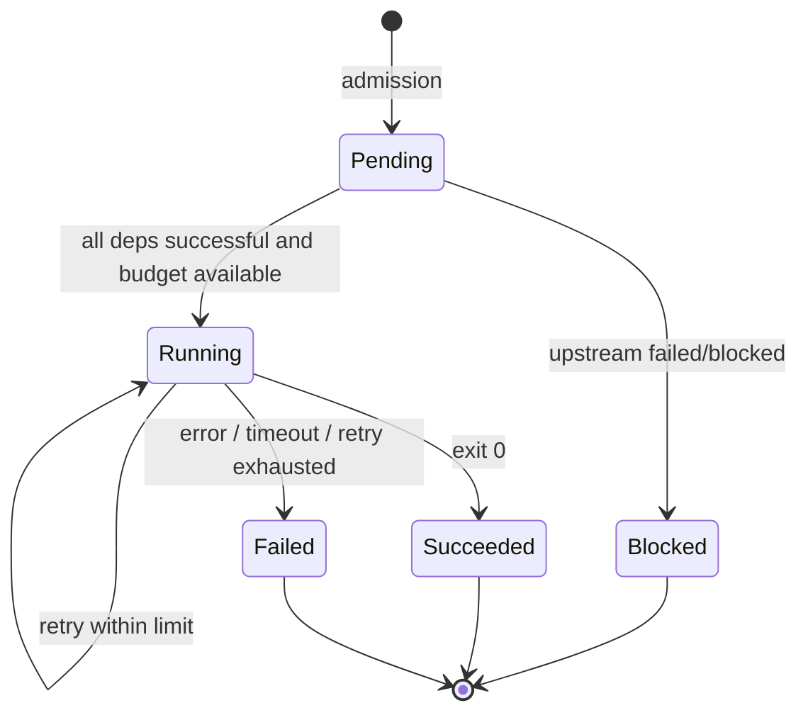
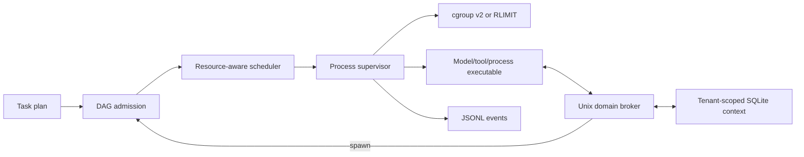

# AgentOS v0.1 架构与实验约束

## 任务管理状态机

## 控制面 / 数据面

## 设计约束

1. 无依赖任务可并行；依赖完成条件为 SUCCEEDED，故障不会导致无关 DAG 分支失败。
2. CPU/memory 预算先在控制面预留，才尝试启动进程；多次重试仍占原预约。
3. 通过 OS 子进程管理生命周期，调度抽象独立于真实模型和工具后端。
4. 消息队列有界，跨租户消息禁止；同一 Unix 用户的恶意执行者不属于当前安全模型。
5. 上下文复用目前限 UTF-8 文本；未实现 vLLM/prefix KV 层的显存共享。
6. 未开启 cgroup 时只保证资源限制的尽力控制，不把进程组视为安全沙盒。

## 公平基线设计

性能报告应固定 OS/内核、CPU/GPU、模型、上下文大小、Agent DAG、
并发度、随机种子、输入输出长度及缓存预热方式。至少比较：
A) 串行执行；B) 纯应用层 DAG；C) 本运行时（无缓存）；
D) 本运行时（上下文复用）；E) 本运行时（cgroup 配额）。
包括总完成时间、p50/p95、吞吐、CPU/RSS/显存、上下文传输字节、
执行失败率与恢复时间。不得将合成 sleep 微基准的结果外推成 LLM 提升比例。
