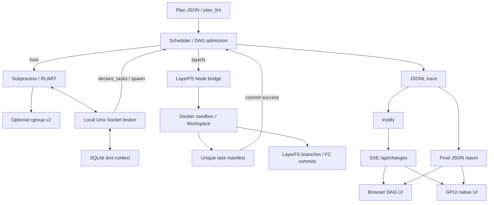
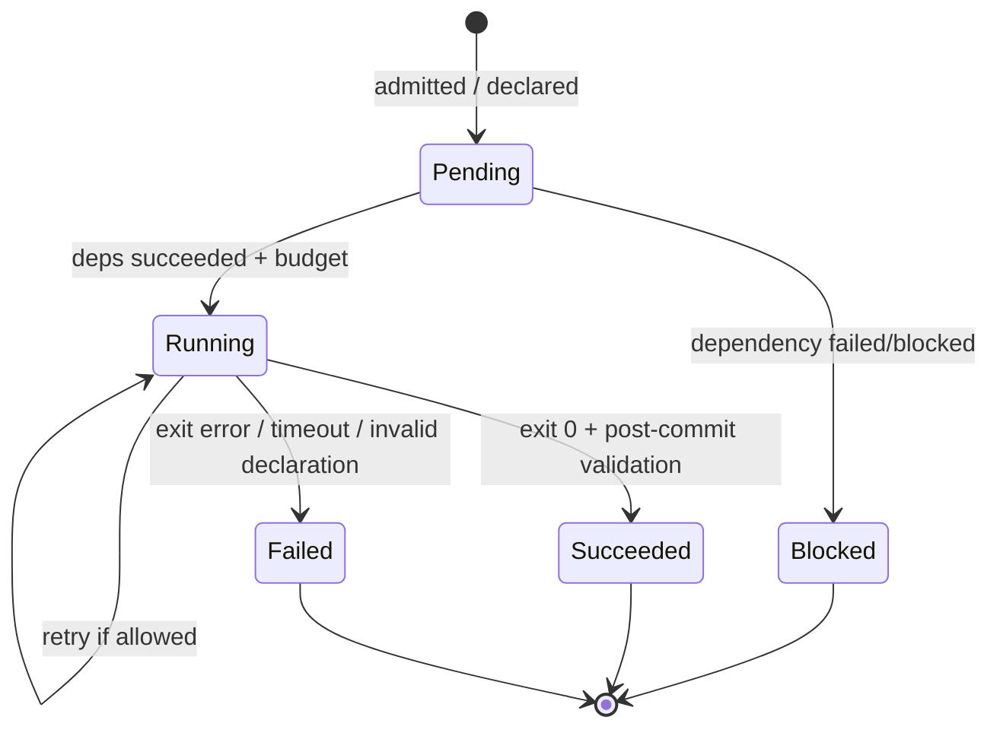
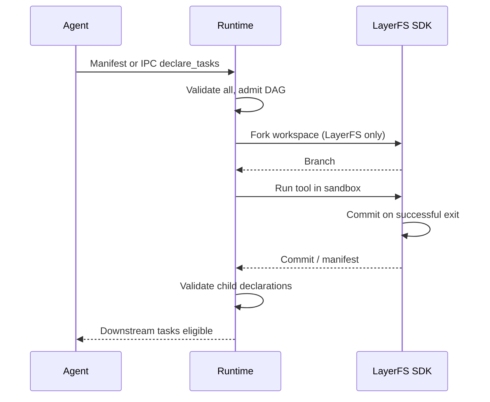

# AgentOS Harness v0.4 架构

当前结构是面向 Linux / openEuler 的**用户态多 Agent 运行时原型**，不是内核修改、生产级多租户沙箱或完整 AgentOS。关键设计是：统一 DAG 与资源预约控制面，Host subprocess 和 LayerFS Docker 两种执行面，共用事件/报告格式。

## 组件与数据流

### 模块职责

| 路径 | 职责 |
| --- | --- |
| `agentos/models.py` | 静态任务参数、预算与执行结果契约 |
| `agentos/plan_lint.py` | 不执行任务的配置与 DAG 预检 |
| `agentos/core.py` | 调度、准入、依赖失败传播、资源槽位、生命周期 |
| `agentos/bus.py`, `client.py` | Host IPC 与动态任务声明 |
| `agentos/context.py` | 有租户隔离的 SQLite/zlib 文本上下文 |
| `agentos/linux.py` | RLIMIT、进程组及可选 cgroup v2 统计 |
| `agentos/layerfs.py`, `layerfs_bridge.mjs` | LayerFS Docker 适配与每任务 Branch |
| `agentos/layerfs_fc.py` | LayerFS 历史/回退的只读查询及非破坏性 fork CLI |
| `agentos/harness_ui.py`, `change_watch.py` | 本地只读 HTTP、inotify、SSE |
| `agentos/harness_run.py` | 执行任务并同时启动本地 UI |
| `agentos/ui/*` | Web DAG、任务详情与时间线 |
| `ui-gpui/src/*` | 原生 GPUI 任务查看器与事件驱动更新 |

## 生命周期与动态 DAG

调度优先级按 `priority` 递减，平级按 `id`。CPU 与内存为**任务启动前的预约槽位**；完成后释放。动态任务在一次声明事务内先校验全部边、租户与预算，再加入 `pending`；每个子任务自动依赖声明者。静态图校验使用非递归拓扑算法，长链不会因 Python 调用栈耗尽。

出现失败时，调度器以固定点迭代传播 `BLOCKED`，避免长链上出现“无可调度任务”误报。完全独立的分支仍可继续。每个 Runtime 实例是单次执行模型，最终释放 IPC、Context 和进程资源。

## 执行面差异

Host 模式运行真实 Linux 子进程；有委派权限时使用 cgroup v2，缺省为 RLIMIT + 进程组。LayerFS 模式通过 Node SDK 在 Docker Sandbox 中执行，**当前不把 AgentOS CPU/内存预算映射为 Docker 限额**，不提供 Host Broker IPC。LayerFS 的 FC 回退只影响文件系统历史，不撤销外部 API 副作用。

## 监控链路：推送而非轮询

1. Runtime 追加 JSONL 事件；终局报告写入 JSON。
2. Linux `inotify` 监听这些固定文件所在目录，包含原子 rename 写入。
3. 本机只读 `/api/changes` SSE 向已连接客户端发送版本变更，心跳是注释，不引发刷新。
4. Web 客户端收到事件时才请求最新状态，同期事件合并；GPUI 先加载摘要，再按需获取选定任务日志。
5. GPUI 任务列表最多每页 40 项，初始窗口由 GPUI 按显示器可见范围裁剪且禁用手动拉伸。

不等于“从进程读取连续的每毫秒 CPU 曲线”：cgroup 指标目前主要在任务完成时取快照，UI 不提供持续高频采样。SSE 监听线程内部允许等待心跳/失败重连，不存在固定周期的任务状态轮询。

## 性能实验设计

固定 OS/内核、CPU/GPU、工作负载、上下文大小、DAG、并发数、输入输出长度、缓存预热、随机种子。至少对比串行、无缓存 DAG、本运行时带/不带上下文复用；如果有实际委派 cgroup 和 LayerFS，再增加相应对照组。报告 p50、p95、吞吐、任务失败率、端到端时延与可观测的内存/CPU 信息。

`bench/benchmark.py` 仅证明合成 sleep 任务的调度并行度，不代表 LLM token/s 或 GPU KV Cache 提速。完整 CI 与统计口径见 [测试与评估](testing.md)。
