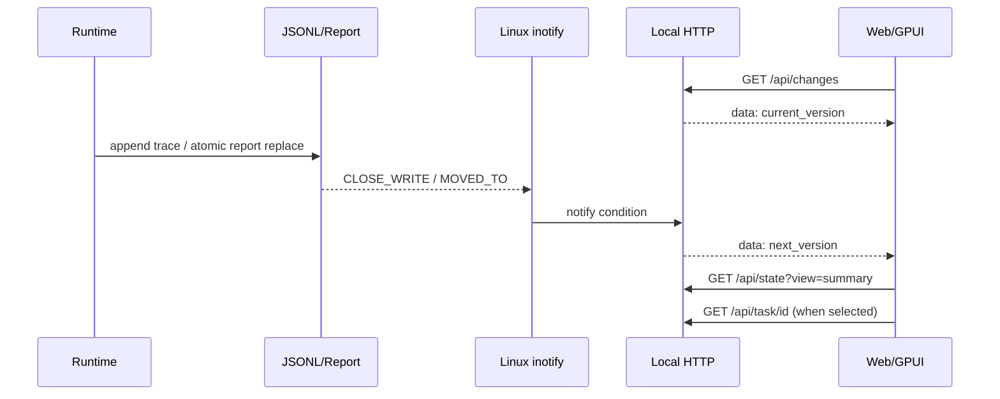

# Harness UI：API、SSE、Lazy Load 与原生 GPUI

本机 HTTP 的完整响应/错误码见 [API 参考](api-reference.md)，机器可读接口为 [OpenAPI 3.1](openapi.json)，JSONL 事件命名及单位见 [Trace 契约](trace-format.md)。

## 使用方式

从 `agentos/` 目录：

```bash
python3 -m agentos.harness_run examples/agent-declarations.json \
  --report /tmp/agentos-report.json --trace /tmp/agentos-trace.jsonl \
  --port 8765 --open-browser
```

`harness_ui` 也能独立服务已有报告。**仅本机 127.0.0.1**、只读 HTTP。它不负责进程调度，没有“Run”或“Rollback”可写端点。

## 请求协议（当前 schema=1）

| 方法 | 路径 | 返回 | 读写性质 |
| --- | --- | --- | --- |
| GET | `/`、`/app.js`、`/styles.css` | UI 静态资源 | 只读 |
| GET | `/healthz` | `{"ok":true}` | 只读 |
| GET | `/api/state` | `schema, tasks, dag, declared_by, events, counts, total, isolation, budget, context, updated_utc` | 只读快照 |
| GET | `/api/state?view=summary` | 同 schema，`events=[]`，任务仅有限字段（状态/耗时/次数/FC ID） | 向后兼容的全部摘要 |
| GET | `/api/state?view=summary&offset=0&limit=40` | 按任务 ID 排序后最多 40 项，保留全局 `total/counts`，仅返回页内 DAG 与声明者 | GPUI 服务端分页 |
| GET | `/api/task/<id>` | `{"task":{...},"spec":{...}}`（完整 stdout/stderr、resource_metrics） | 选择任务后加载 |
| GET | `/api/changes` | `text/event-stream` 的版本事件 | 监听，不更改状态 |
| POST | 任意路径 | 405 | 禁止写操作 |

`<id>` 仅允许 `[A-Za-z][A-Za-z0-9_.-]{0,63}`，未知任务 404。HTTP 必须带正确的 `Host: 127.0.0.1:<实际端口>`，不允许通过其他主机名利用 DNS rebinding。当前服务不支持公网端口、远程用户登录与跨域接口。

### 简化的响应示例

```json
{
  "schema": 1,
  "tasks": {
    "planner": {"id": "planner", "status": "succeeded", "attempts": 1}
  },
  "dag": {"planner": {"deps": [], "kind": "model", "tenant": "default"}},
  "declared_by": {},
  "counts": {"pending": 0, "running": 0, "succeeded": 1, "failed": 0, "blocked": 0},
  "total": 1,
  "events": [],
  "isolation": "trace-only",
  "budget": {},
  "context": {},
  "updated_utc": "2026-10-28T00:00:00+00:00"
}
```

`/api/state?view=summary` 的“轻量”指**传输负载裁剪**；服务端首次读取或文件发生变化时会解析 Report/Trace 并建立进程内快照缓存；后续同版本的分页/详情请求复用缓存。目前尚未对服务端事件数组或 DAG 建立持久索引，不要把此 API 误认为 O(1) 读盘。

## 事件驱动变化通知



- SSE **连接后立即发送版本**，之后只在监听的报告/Trace 文件发生变化时推送更新。
- SSE 每约 20 秒发送 `: heartbeat` 注释保持 TCP 长连接；客户端不将心跳视为刷新。
- Web UI 合并高频事件请求，GPUI 用单独线程等待通知，在 UI 线程中更新模型；断线才按重连间隔再连接（并非固定频率轮询）。
- GPUI 请求 `view=summary&offset=N&limit=40`，服务端只传当前 40 个任务、关联 DAG 和声明关系；`total/counts` 保留全局统计。选中 Agent 后才请求 `/api/task/<id>`；分页和 SSE 通知才触发页面请求。不需要下载所有任务再在 GPUI 客户端裁剪。
- 浏览器 DAG 图最多显示前 **160 个任务节点**；完整任务仍在报告与表格中。页面没有对 10,000 任务进行 GPU 加速的性能保证。
- GPUI 初始尺寸为 1140 × 760 **逻辑像素请求**，调用 GPUI `Bounds::centered` 按当前屏幕可见范围裁剪，窗口当前设置为不可任意拉伸；不要将逻辑像素等同于高 DPI 物理像素。

### 资源与边界

Report 上限 **8 MiB**，Trace 每次读取末尾 **2 MiB**、最多保留 **4,000 条**解析成功的事件；网络层 GPUI 响应上限约 8 MiB。大文件会报错/仅展示末尾，并不对全部历史做无界扫描。stdout/stderr 以纯文本显示；Node/浏览器/GPUI 均不从日志中执行命令。

当前 AgentOS 的 cgroup 资源统计主要发生在任务执行结束时，不会产生持续每帧的进程性能曲线；`memory_peak` 等指标只在内核暴露对应数据时出现。图表不应虚构真实采样值。

## 本机调试

```bash
curl -sS http://127.0.0.1:8765/healthz
curl -sS http://127.0.0.1:8765/api/state?view=summary | python3 -m json.tool
curl -N http://127.0.0.1:8765/api/changes
curl -sS http://127.0.0.1:8765/api/task/planner | python3 -m json.tool
```

当 LayerFS 没装好、没有提交记录、Trace 尚未创建或某任务尚未结束时，显示空值并非 FC 已经完成；应该用 `/api/state` 的 `tasks` 和 `events` 判断实际状态。
