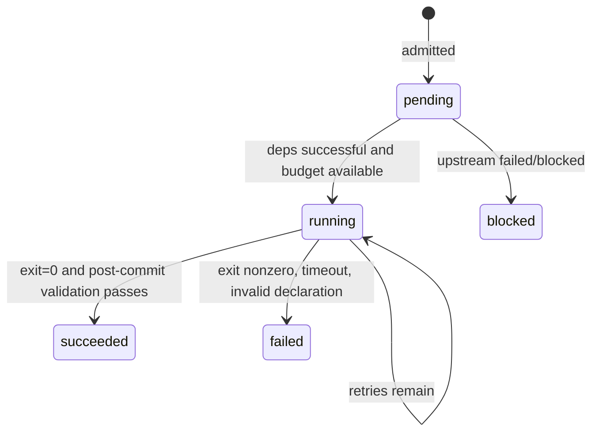

# Trace、终局报告与事件语义

生命周期事件由 `AgentRuntime._event` 以 **JSON Lines (JSONL)** 追加写入。新运行的每条事件增加 `seq`（从 0 开始连续递增）、`session_id`（每次 AgentOS 执行唯一的随机 ID）与 `agent_path`（动态声明者祖先链；初始 Task 为 `[]`）。这些是 **AgentOS Supervisor 自己观察到的事实**，不是第三方模型运行时的原生帧。旧 Trace 没有这些字段，仍可用于旧版 UI，但不能使用严格的游标重放。每行是独立 JSON 对象，包含 `time_ns`（Unix 纳秒整数）、`event`（事件名）与按事件决定的附加键；同一条事件在 `runtime.events` 中也有内存副本。

## 事件字典

| `event` | 产生时机 | 主要字段 |
| --- | --- | --- |
| `admitted` | 初始/动态任务成功进入调度器 | `task, tenant, kind, deps, priority, cpu_units, memory_mib` |
| `declared` | Agent 通过 IPC / LayerFS Manifest 自主声明成功 | `task, parent, tenant, deps` |
| `started` | 任务进入 RUNNING、已预约资源 | `task, cpu_units, memory_mib` |
| `retry` | 可重试失败且尚有剩余尝试次数 | `task, attempt, error` |
| `declaration_rejected` | Manifest 校验或动态声明被拒绝 | `task, error` |
| `finished` | 任务进入 SUCCEEDED 或 FAILED | `task, status, attempts, elapsed_s, error, resource_metrics` |
| `blocked` | 上游失败导致尚未启动的任务阻断 | `task` |
| `control_requested` | Host IPC 已认证请求进入 Broker | `task, request_id, op`（无 token / payload / context） |
| `control_handled` | Broker 已处理请求，结果已确定，但不证明对端收到响应 | `task, request_id, accepted, code` |


例如：

```json
{"time_ns":1793000000000000000,"event":"admitted","task":"planner","tenant":"default","kind":"model","deps":[],"priority":0,"cpu_units":1,"memory_mib":128}
```

```json
{"time_ns":1793000000100000000,"event":"finished","task":"planner","status":"succeeded","attempts":1,"elapsed_s":0.1,"error":"","resource_metrics":{}}
```

`blocked` 只包含 `task`，用户界面将其转换为 `status=blocked`、`error=dependency failed` 的推导展示。不要把这种显示值当成已经从 Worker 收到的原始状态。

## 状态机与保证



状态并不等同事件名：`declared` 是任务纳管关系，`started` 是状态过渡；`finished` 携带最终 `status`；`retry` 仍属于同一 Task 的 RUNNING 生命周期。动态子任务自动依赖父任务，父任务 FAILED 则它会被 BLOCKED。另有独立 DAG 分支可以继续。

## 严格游标重放

`GET /api/records` 是一个只读的已观察事件窗口。首次请求不带游标或使用 `after=-1`；后续必须同时传入服务返回的 `session_id` 和 `next_seq`。它最多返回 200 条事件，`has_more` 表示完整 Trace 中还有后续记录。服务端在第一次查询时扫描完整 JSONL 并建立内存中每 128 个事件一条的稀疏文件偏移索引；之后仅索引新追加的完整行。Trace 大于 UI 尾窗 2 MiB 或多于 4000 条事件时仍可从最早事件重放，前提是原始 JSONL 没有丢失。若文件历史确实截断、完整行格式损坏、事件缺号、旧格式事件或会话替换，将返回 409，**不会猜测或补造漏失数据**。写入中的最后半行暂不成为可重放事实。内核 inotify/SSE 仍只负责通知变化，重放与消息通知是不同层级。相关设计参见 [OAR 对照与取舍](oar-comparison.md)。

```bash
curl -fsS 'http://127.0.0.1:8765/api/records?limit=100'
# 接续：把响应里的 session_id 与 next_seq 原样带入
# /api/records?after=99&limit=100&session_id=<server returned session_id>
```

**Replay ≠ Resume**：这里仅重放已写入磁盘的 AgentOS Supervisor 事实，不恢复被杀掉的子进程、模型上下文、工具调用或外部副作用。

## 报告与 Trace 的关系

`agentos.cli` 的 `--report` 写完整终局 Report，`--trace` **追加**事件；`harness_run` 使用原子替换 Report 的方式完成提交，启动时清空指定 Trace。两个入口的日志保留策略并不相同。

终局报告不含统一的 `schema` 键，其基本结构是：

```json
{
  "budget": {"cpu_units":2,"memory_mib":512,"max_tasks":16},
  "isolation": "rlimit",
  "tasks": {"planner": {"id":"planner","status":"succeeded","attempts":1}},
  "dag": {"planner": {"deps":[],"kind":"model","tenant":"default",
            "priority":0,"cpu_units":1,"memory_mib":128}},
  "context": {},
  "declared_by": {},
  "events": []
}
```

**注意**：示例省略了 `AgentResult` 的部分字段，仅用于说明结构。实际运行结果中的 `tasks` 包含完整字段。UI 通过 `build_state` 合并当前 Trace 和终局 Report，得到独立的 `schema=1` 视图。

终局报告会写入 Supervisor `session_id` 和 `last_seq`；独立运行会话的 `manifest.json` 同样保留它们，供只读 `agentos.sessions verify` 校验 Trace 的顺序和身份。参见 [会话核验](run-sessions.md)。

## 数据生命周期与隐私

- Trace 不携带任务完整 stdout/stderr；但 `retry/declaration_rejected/finished` 的错误和指标可能包含敏感信息。
- 完整 stdout/stderr 只在终局 Report 的任务结果中出现；目前单个 stdout/stderr 流最多允许收集 512 KiB。
- Trace 尾部窗口与 Report 体积限制只是 UI 的读取限制，**不是**自动日志轮转或加密。
- 确保报告/Trace/SQLite/LayerFS Store 的主机访问权限，不要把用户令牌、私钥或业务敏感上下文写入公开 CI 日志。
- 保存实验记录时将“任务执行错误”和“监控服务读取错误”分开，不从 `/api/state=500` 断定 Agent 任务状态。
